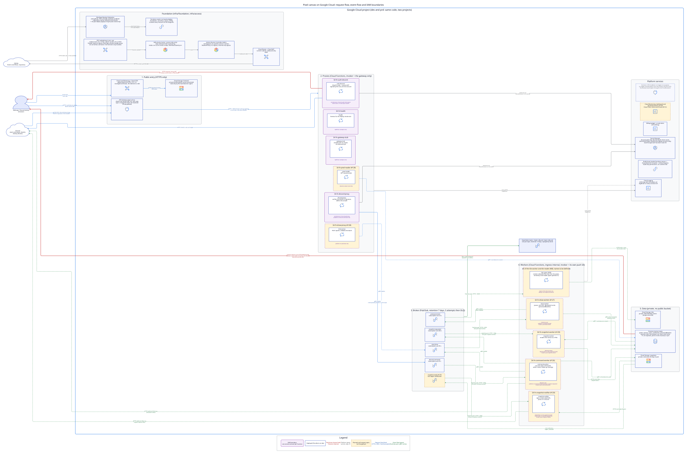
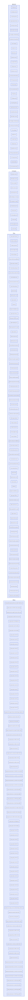

# Architecture

Two diagrams, with two different jobs:

| Diagram | Job | Source | Kept up to date by |
| --- | --- | --- | --- |
| **Reference diagram** (below) | explains the design: layers, flows, protocols, IAM boundaries, official Google Cloud icons | `architecture/pixel-canvas.d2`, written by hand | the author of every pull request that changes the architecture (checkbox in the PR template) |
| **Deployed inventory** ([bottom of the page](#deployed-inventory-generated)) | proves what really exists: every resource of the deployed Terraform state | `terraform show -json` of `prd` and `dev` | the `architecture` workflow, after each production deployment |

The reference diagram is what we present. The inventory is what we compare it with when we review it
against the deployed project.

## Reference diagram



Source: [`architecture/pixel-canvas.d2`](architecture/pixel-canvas.d2). Icons: the official Google Cloud icon
library, see [`architecture/icons/README.md`](architecture/icons/README.md) (origin, licence, why they are copied).

How to read it:

- Requests go **one way**: Discord / web app, then API Gateway, then the proxies, then Pub/Sub, then the workers, then
  the data. The only way back is the real-time channel (red): the browser reads Firestore.
- **Solid boxes are deployed** by the Terraform of `dev`. **Dashed amber boxes and arrows are planned**: their pull
  request is open and not merged yet (see [Deployed or planned](#deployed-or-planned)).
- **Purple boxes are IAM boundaries**: one service account per function, listed with its permissions. A function
  never uses another function's account.
- Arrow colour: blue = request flow, green = event flow, red = real-time channel, grey = platform. Every label starts
  with the protocol.

### Arrow by arrow

| Flow | From, to | Protocol | Who is authenticated, how | Terraform |
| --- | --- | --- | --- | --- |
| Static app | browser, load balancer, `frontend` bucket | HTTPS (HTTP is redirected with a 301) | public by design; the bucket stays private, only the load balancer agent reads it | `infra/serverless/frontend.tf` |
| Discord command | Discord, API Gateway `/discord/interactions` | HTTPS POST | the proxy verifies the Ed25519 signature of the raw body (no JWT: Discord sends none) | `gateway.tf`, `openapi/api.yaml.tftpl` |
| Login | browser, API Gateway `/auth/discord`, `auth-discord`, Discord | HTTPS, then OAuth2 code exchange | none yet (this call creates the session); the function checks the redirect URI against an allow-list | `auth_discord.tf` |
| Drawing, reading | browser, API Gateway `/pixels`, proxies | HTTPS + `Authorization: Bearer <JWT>` | the gateway checks signature (keys published for the SA of `auth-discord`), `iss`, `aud`, `exp`: `401` otherwise | `gateway.tf` |
| Gateway to proxy | API Gateway, function | HTTPS + Google ID token (OIDC) | SA `api-gateway` holds `run.invoker` on each function, nobody else does | `modules/function` (`invokers`) |
| Publish | proxy or worker, Pub/Sub topic | gRPC (client library) | `roles/pubsub.publisher` on **that topic only** | `modules/pubsub` |
| Push | subscription, worker | HTTPS POST + OIDC token | the subscription signs as `push-<worker>`, the only account with `run.invoker` on the worker, which is `ALLOW_INTERNAL_ONLY` | `modules/pubsub` (`push`) |
| Dead letter | subscription, `<topic>.dlq` | Pub/Sub | after 5 failed deliveries, with exponential backoff 10 s to 600 s; the Pub/Sub service agent publishes | `modules/pubsub` |
| Storage write | worker, Firestore / bucket | gRPC / HTTPS | `datastore.user` or `datastore.viewer` (project level: Firestore has no finer IAM), `storage.objectCreator` / `objectViewer` on the bucket | `*_worker.tf`, `snapshots.tf` |
| Bucket event | `snapshots` bucket, `snapshot.ready` topic | GCS notification (`OBJECT_FINALIZE`) | the Cloud Storage service account publishes | `snapshots.tf` |
| Real time | Firestore, browser | Firestore listeners over HTTPS (WebChannel) | custom Firebase token minted by `auth-discord`; the rules allow reads only, never writes | `firestore.rules` |
| Secrets | function, Secret Manager | secret mounted as an environment variable | `secretAccessor` on the secrets of that function only | `modules/function` (`secret_env`) |
| Logs | function, Cloud Logging | stdout JSON | `logWriter`, `cloudtrace.agent` on its own SA | `modules/function` |
| CI deploy | GitHub, Workload Identity Federation, `gha-deploy` | HTTPS OIDC | attribute condition: repository, owner and GitHub Environment | `infra/access/wif.tf` |
| CI runners | runners (GKE) to GitHub | HTTPS outbound through Cloud NAT | no ingress at all (deny-all firewall and NetworkPolicy) | `infra/foundation` |

### What the diagram says about the constraints of the subject

- **Public entries**: the API Gateway and the load balancer, nothing else. The proxies are `ALLOW_ALL` at the network
  level (API Gateway reaches them through their `run.app` URL), but IAM refuses everyone except SA `api-gateway`: a
  direct call without that identity is refused (`401` or `403`). The workers are `ALLOW_INTERNAL_ONLY` **and** restricted to their push account.
- **Buckets are never public**: `public_access_prevention = enforced` on `frontend`, `tiles`, `snapshots` and
  `functions-source`.
- **VPC**: only the CI runners live in it. The functions are serverless and do not use a Serverless VPC connector,
  which is why the VPC box is in the foundation layer and has no arrow from the application.
- **Eventarc**: the API is enabled (Cloud Functions 2nd gen needs it) but no trigger is created, on purpose: an
  Eventarc trigger creates its own subscription, without our retry policy and dead-letter topic
  ([pubsub.md](pubsub.md)). The bucket event goes through a GCS notification to a topic instead.
- **Prd and dev**: same code, two Google Cloud projects. Prd runs in `europe-west9` (the gateway in `europe-west1`,
  the nearest region where API Gateway exists), dev in `europe-west1`. The runners cluster, Cloud NAT and ARC exist
  in dev only.

### Deployed or planned

State on `dev` when this page was written. Remove the `planned` class in the D2 file when each pull request is merged.

| Part | Status | Reference |
| --- | --- | --- |
| VPC, subnets, firewall, Cloud NAT, GKE runners, ARC, WIF | deployed | `infra/foundation`, `infra/access` |
| API Gateway, `health`, `gateway-stub`, `discord-proxy`, `auth-discord` | deployed | `infra/serverless` |
| Pub/Sub topics, subscriptions (pull for now) and DLQs | deployed | `modules/pubsub` |
| Firestore, rules, indexes, TTL, buckets, Secret Manager (data sources) | deployed | `firestore.tf`, `storage.tf`, `secrets.tf` |
| Frontend hosting (bucket, LB, CDN) | deployed | `frontend.tf` |
| Command worker | planned | #126 |
| Draw worker | planned | #127 |
| `draw-proxy`, `pixel-reader`, real routes of `/pixels` | planned | #128 |
| Snapshot worker and notifier, `snapshot.ready` | planned | #129 |
| Monitoring dashboard and log-based metrics | planned | #130 |
| End-to-end tracing (Cloud Trace) | planned | #131 |
| Tile rasters (tile worker and reader) | planned, names to be defined | #68 |

> **Provisional decision.** The planned parts are drawn dashed instead of being left out, so that the diagram shows the
> target design the team defends. The alternative (drawing only what is merged) gives a diagram that is exact today but
> without workers, which hides the event flow. When the pull requests merge, their boxes become solid.

## Updating the diagram

Every pull request that changes the architecture (a new function, topic, bucket, route, service account, network
piece) edits `architecture/pixel-canvas.d2` and the SVG in the same pull request. The checkbox "architecture diagram
updated" of the pull request template reminds you.

Render it with [D2](https://d2lang.com). The committed SVG was rendered with D2 0.9.0 (Homebrew); after `deploy-prd`,
`architecture.yml` renders it again with its own `D2_VERSION` (0.6.9), so the layout of that copy can differ slightly
until both versions are aligned:

```sh
d2 docs/architecture/pixel-canvas.d2 docs/architecture/pixel-canvas.svg
```

The layout engine (ELK) and the theme are set in the `d2-config` block at the top of the file, so no flag is needed.
Then open the SVG: check that every label is readable, that no arrow crosses a box it should not, and that the legend
is complete.

The `architecture` workflow also renders it after each production deployment and includes it in its pull request, so
the SVG on `dev` cannot drift from the `.d2` for long.

Review checklist against the deployed production project (what the three members check together):

1. Every solid box exists in `prd` (Terraform state or console), with the same name and region.
2. Every arrow exists: the push subscriptions point to the right worker, the gateway routes to the right function.
3. Every function has its own service account and the permissions written in its purple box, nothing more.
4. No bucket and no function is reachable without going through the gateway or the load balancer.
5. The dashed boxes are exactly the pull requests that are still open.

## Deployed inventory (generated)



The inventory is generated after every successful production deployment, from the deployed Terraform state, and
proposed through a pull request. It is **reviewed by a team member before merge**: the review stays mandatory. It
lists resources, grouped and labelled by a model; it does not show flows, protocols or IAM, which is why the reference
diagram is written by hand: those facts are not in the resource list (`terraform show` without attribute values).

- Source of truth: `terraform show -json` of the `foundation` and `serverless` stacks (`prd` and `dev`).
- Files in `docs/architecture/`: `architecture.svg` (rendered), `architecture.d2` (source), `architecture.json`
  (grouping and labels returned by the model, already verified).
- Workflow: `.github/workflows/architecture.yml`, scripts in `.github/scripts/architecture/`.

### How it works

1. `extract` reads the state and keeps only resource addresses, types, names and references. Attribute values
   are dropped because they can contain sensitive data.
2. `generate` asks `claude-haiku-5-5` to group the resources (network, compute, data, observability), label them
   and list the links. The answer is JSON, and the job fails if it cites a resource that is not in the state.
3. `publish` renders the JSON to D2 with our own script (sorted output, fixed groups, so diffs stay small),
   renders the SVG, renders the reference diagram too and opens a PR against `dev`.

The model never writes executable code, which is why the source format is D2 rather than the Python `diagrams`
library: nothing returned by the model is ever run.

### Configuration

- `ANTHROPIC_API_KEY`: secret of the `prd` GitHub Environment. Set a spending limit on the key.
- `RELEASE_APP_ID`, `RELEASE_APP_PRIVATE_KEY`: repository secrets, shared with the release workflow (the app needs
  Pull requests: write to open the PR).
- Check the model identifier in the API documentation if it changes (the repository variable `ARCH_MODEL` overrides it).

To try it without a release, run the `architecture` workflow manually (Actions, `architecture`, Run workflow) **from `dev` or from a `v*` tag**: the `dev` environment, read by `extract (dev)`, refuses other branches such as `main`.
