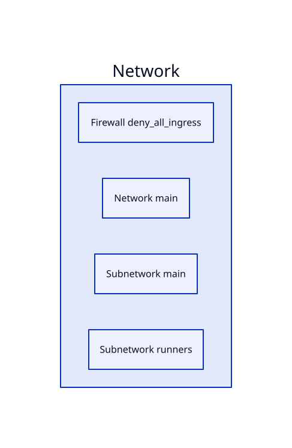

# Architecture

The diagram is generated after every successful production deployment, from the deployed Terraform state, and
proposed through a pull request. It is **reviewed by a team member before merge**: the review stays mandatory.

- Source of truth: `terraform show -json` of the `foundation` and `serverless` stacks (`prd`).
- Files in `docs/architecture/`: `architecture.svg` (rendered diagram), `architecture.d2` (diagram source),
  `architecture.json` (grouping and labels returned by the model, already verified).
- Workflow: `.github/workflows/architecture.yml`, scripts in `.github/scripts/architecture/`.

## How it works

1. `extract` reads the state and keeps only resource addresses, types, names and references. Attribute values
   are dropped because they can contain sensitive data.
2. `generate` asks `claude-haiku-5-5` to group the resources (network, compute, data, observability), label them
   and list the links. The answer is JSON, and the job fails if it cites a resource that is not in the state.
3. `publish` renders the JSON to D2 with our own script (sorted output, fixed groups, so diffs stay small),
   renders the SVG and opens a PR against `dev`.

The model never writes executable code, which is why the source format is D2 rather than the Python `diagrams`
library: nothing returned by the model is ever run.

## Configuration

- `ANTHROPIC_API_KEY`: secret of the `prd` GitHub Environment. Set a spending limit on the key.
- `RELEASE_APP_ID`, `RELEASE_APP_PRIVATE_KEY`: repository secrets, shared with the release workflow (the app needs
  Pull requests: write to open the PR).
- Check the model identifier in the API documentation if it changes (the repository variable `ARCH_MODEL` overrides it).

To try it without a release, run the `architecture` workflow manually (Actions, `architecture`, Run workflow).
